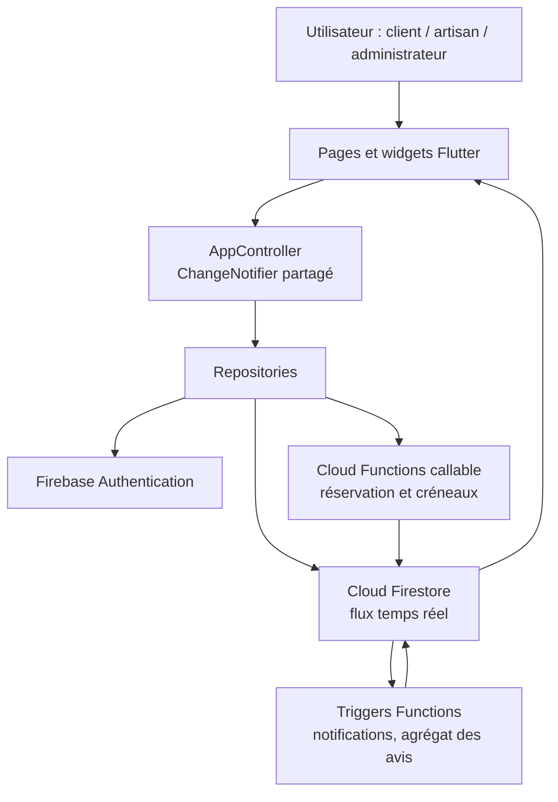
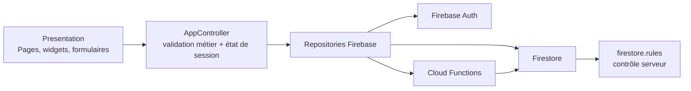
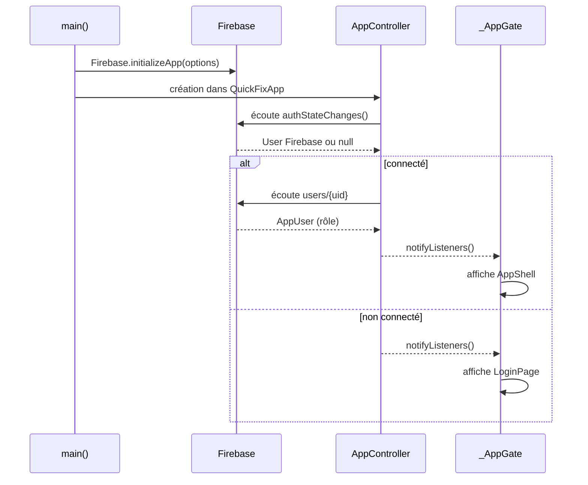
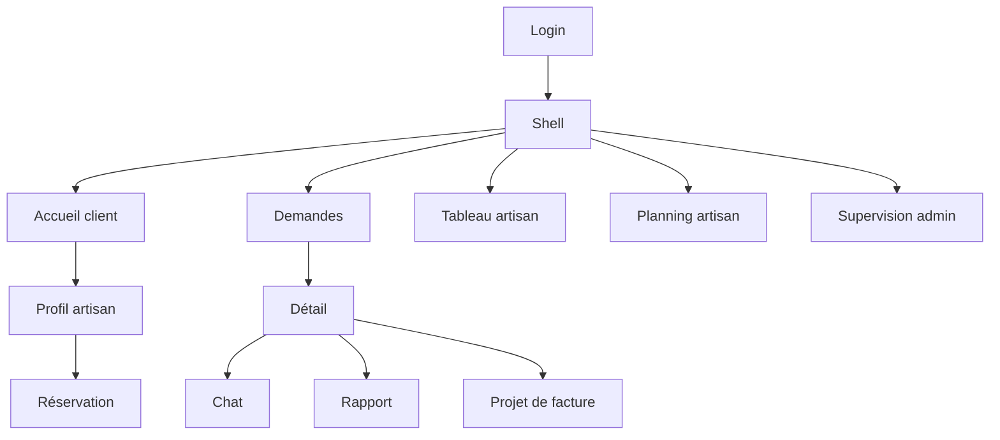

# Guide technique et pédagogique — QuickFix Tunisia

> Périmètre de cette analyse : code Flutter/Dart, règles Firestore et Cloud Functions Node.js présents dans ce dépôt. Les affirmations ci-dessous décrivent le code versionné, pas une architecture Flutter théorique.

# Comprendre le projet en 5 minutes

**QuickFix Tunisia** met en relation des clients avec des artisans pour une intervention à domicile. Un client recherche un artisan validé, enregistre une adresse, réserve un créneau et suit sa demande. L’artisan publie ses disponibilités, envoie un devis, réalise l’intervention, rédige un rapport, puis peut partager un projet de facture. Un administrateur valide les artisans et supervise les demandes.

Techniquement, c’est une application Flutter unique, organisée par fonctionnalités sous `lib/features/`. L’interface ne possède pas de serveur HTTP classique : elle utilise les SDK Firebase :

- Firebase Authentication pour la session e-mail/mot de passe ;
- Cloud Firestore pour les profils, demandes, messages, avis, notifications et projets de facture ;
- Cloud Functions pour calculer et réserver les créneaux de manière transactionnelle, expirer les réservations et créer des notifications ;
- le package `pdf` génère le PDF de facture localement, à la demande. Aucun fichier PDF n’est envoyé dans Firebase Storage.

`AppController` est l’objet d’état partagé par l’UI. Il vérifie les rôles et les règles métier côté client, puis délègue les lectures/écritures à de petits repositories Firebase. Les règles de [Firestore](firestore.rules) font ensuite autorité : elles empêchent un client modifié ou malveillant d’écrire en dehors des droits prévus.



La navigation principale dépend du rôle : client = Accueil / Demandes / Compte ; artisan = Tableau de bord / Planning / Interventions / Compte ; administrateur = Supervision / Demandes / Compte. Le thème suit le réglage clair/sombre du système.

# Structure du projet

```text
lib/
  main.dart                         démarrage Firebase et Flutter
  app/                              application, thème, routes
  core/                             modèles, état partagé, widgets/utilitaires transverses
  features/
    auth/                           connexion, inscription, mot de passe oublié
    artisans/                       catalogue et fiche artisan
    availability/                   planning artisan
    request/                        réservation, suivi, rapport, facture
    chat/, reviews/, notifications/ services associés aux demandes
    activity/, home/, account/, admin/, shell/ écrans par rôle et conteneur de navigation
functions/                          Cloud Functions Firebase Node.js
firestore.rules                     autorisations Firestore côté serveur
test/                               tests Dart / Flutter
functions/test/                     tests Node des calculs de créneaux
```

| Dossier/fichier | Rôle | Contenu à chercher |
|---|---|---|
| [`lib/main.dart`](lib/main.dart) | point de départ | initialise Firebase avant `runApp` |
| [`lib/app/`](lib/app) | application globale | `MaterialApp`, thème et routes nommées |
| [`lib/core/models/`](lib/core/models) | données typées | modèles immuables et conversions Firestore |
| [`lib/core/state/`](lib/core/state) | état partagé | `AppController` et son accès dans l’arbre Flutter |
| [`lib/features/<feature>/data/`](lib/features) | accès données | repositories Firebase, pas de requête dans les widgets |
| [`lib/features/<feature>/presentation/`](lib/features) | interface | pages, formulaires, listes, état local bref |
| [`functions/index.js`](functions/index.js) | logique serveur Firebase | réservation atomique, tâches et triggers |
| [`firestore.rules`](firestore.rules) | sécurité effective | droits de rôle et transitions autorisées |

La structure est **par fonctionnalités dans la présentation et par responsabilité dans `core`**. Elle n’est pas une Clean Architecture stricte : il n’y a pas de couche `domain` ni d’interfaces abstraites de repository. Chaque repository connaît directement le SDK Firebase, et `AppController` joue à la fois le rôle de contrôleur applicatif, de façade pour l’UI et de conteneur léger de dépendances.

# Les concepts Flutter nécessaires pour comprendre ce projet

| Concept | En une phrase et intérêt | Dans QuickFix |
|---|---|---|
| `Widget` | Une description immuable d’un morceau d’interface ; Flutter reconstruit cette description quand les données changent. | Toutes les pages, par exemple [`HomePage`](lib/features/home/presentation/home_page.dart). |
| `StatelessWidget` | Widget sans état local mutable, adapté à un affichage issu de ses paramètres ou d’un flux. | [`ArtisanDetailPage`](lib/features/artisans/presentation/artisan_detail_page.dart) reçoit un `Artisan` et l’affiche. |
| `StatefulWidget` + `State` | Paire utilisée quand l’écran garde un état local (texte saisi, filtre, chargement). | [`RequestFormPage`](lib/features/request/presentation/request_form_page.dart) conserve le créneau, les contrôleurs et `_submitting`. |
| `setState` | Signale à Flutter que l’état local a changé et qu’il faut rebâtir ce widget. | Les filtres de [`HomePage`](lib/features/home/presentation/home_page.dart) et l’onglet choisi de [`AppShell`](lib/features/shell/presentation/app_shell.dart). Il ne sert pas aux données globales Firestore. |
| `BuildContext` | Position d’un widget dans l’arbre ; il permet ici de récupérer le contrôleur, le thème et le navigateur. | `AppScope.of(context)` dans les pages ; après un `await`, plusieurs pages vérifient `mounted` avant de l’utiliser. |
| `MaterialApp` / `Scaffold` | `MaterialApp` installe thème et navigation ; `Scaffold` donne la structure d’un écran Material (barre, corps, navigation). | [`QuickFixApp`](lib/app/app.dart) et les pages comme [`RequestDetailsPage`](lib/features/request/presentation/request_details_page.dart). |
| `Future`, `async` / `await` | Représentent une opération qui finira plus tard, comme une écriture Firebase. | `_submit()` de [`RequestFormPage`](lib/features/request/presentation/request_form_page.dart) attend la Function de réservation. |
| `Stream` / `StreamBuilder` | Un flux réémet à chaque changement ; `StreamBuilder` reconstruit la zone UI concernée. | `watchArtisans()` alimente le catalogue dans [`HomePage`](lib/features/home/presentation/home_page.dart) en temps réel. |
| `FutureBuilder` | Affiche les états d’une valeur asynchrone ponctuelle. | l’adresse privée dans [`RequestDetailsPage`](lib/features/request/presentation/request_details_page.dart) et le calendrier de réservation. |
| `ChangeNotifier` / `InheritedNotifier` | `ChangeNotifier` publie un changement ; `InheritedNotifier` rend le même objet accessible et écoutable à ses descendants. | [`AppController`](lib/core/state/app_controller.dart) est fourni par [`AppScope`](lib/core/state/app_scope.dart). Ce n’est pas le package Provider. |
| routes nommées | Une table centrale associe un nom et un argument typé à une page. | [`AppRoutes`](lib/app/app_routes.dart), par exemple `/demande` exige un `Artisan`. |

# Architecture de l’application

## Les couches réellement présentes



1. **Présentation** — les pages collectent les actions, valident les formulaires et affichent chargement/erreur. Elles appellent presque toujours `AppScope.of(context)` plutôt qu’un SDK Firebase.
2. **Contrôleur global** — [`AppController`](lib/core/state/app_controller.dart) détient l’utilisateur courant, écoute Firebase Auth et le document Firestore associé, expose les flux et centralise les vérifications de rôle, de transition et de format.
3. **Repositories** — par exemple [`RequestRepository`](lib/features/request/data/request_repository.dart) encapsule les chemins Firestore. Ils convertissent les snapshots en modèles Dart et ne prennent pas de décisions de navigation.
4. **Backend Firebase** — les règles et [Functions](functions/index.js) sont complémentaires au contrôleur : le contrôleur améliore l’expérience utilisateur, mais ne constitue pas une frontière de sécurité.

## Exemple : réserver un créneau

`RequestFormPage` charge les dates et créneaux via `AppController.availableBookingDays/availableSlots()` → [`BookingRepository`](lib/features/request/data/booking_repository.dart) appelle les Functions `availableBookingDays` et `availableSlots` → [`functions/index.js`](functions/index.js) applique le planning, les absences et les collisions → l’écran affiche les `BookingSlot`.

Lors de la validation, `RequestFormPage._submit()` → `AppController.createRequest()` (client obligatoire) → `BookingRepository.reserve()` → Function `reserveBooking`. Cette Function relit le client, l’adresse et l’artisan, revérifie le créneau **dans une transaction**, crée `requests/{id}`, puis écrit l’adresse complète dans `requests/{id}/private/location`. Le trigger `notifyArtisanOfNewRequest` ajoute enfin une notification dans `notifications`.

# Modules et fonctionnalités

## Authentification et inscription

Objectif : créer un compte client ou artisan, connecter la session et demander un lien de réinitialisation.

| Type | Fichier | Rôle |
|---|---|---|
| Pages | [`login_page.dart`](lib/features/auth/presentation/login_page.dart), [`forgot_password_page.dart`](lib/features/auth/presentation/forgot_password_page.dart) | formulaires, validation et messages génériques |
| Repository Auth | [`auth_repository.dart`](lib/features/auth/data/auth_repository.dart) | encapsule `FirebaseAuth` |
| Repository profil | [`profile_registration_repository.dart`](lib/features/auth/data/profile_registration_repository.dart) | transaction créant `users/{uid}` et éventuellement `artisans/{uid}` |
| Modèles | [`app_user.dart`](lib/core/models/app_user.dart), [`artisan.dart`](lib/core/models/artisan.dart) | rôle et profil professionnel |

Flux : formulaire → `AppController.signIn()` ou `register()` → Firebase Auth → à l’inscription, transaction Firestore du profil → le flux `authStateChanges` est reçu par `AppController` → écoute de `users/{uid}` → `_AppGate` remplace la page de connexion par `AppShell` quand l’utilisateur Firestore est disponible.

L’administrateur ne peut pas être inscrit dans l’app : `AppController.register()` le refuse et les règles n’autorisent que `client`/`artisan` lors de la création d’un utilisateur.

## Catalogue et profil artisan

| Type | Fichier | Rôle |
|---|---|---|
| Écrans | [`home_page.dart`](lib/features/home/presentation/home_page.dart), [`artisan_detail_page.dart`](lib/features/artisans/presentation/artisan_detail_page.dart) | recherche, filtres, fiche et avis |
| Repository | [`artisan_repository.dart`](lib/features/artisans/data/artisan_repository.dart) | lit `artisans`, ne montre au catalogue que `verified == true` |
| Modèles | [`artisan.dart`](lib/core/models/artisan.dart), [`artisan_catalog.dart`](lib/core/models/artisan_catalog.dart) | profil, statut de vérification, métiers/zones contrôlés |
| Utilitaire | [`availability_calculator.dart`](lib/core/services/availability_calculator.dart) | indicateur local « disponible aujourd’hui » |

Le client reçoit le flux temps réel `watchArtisans`, filtre localement nom/métier/zone/disponibilité, ouvre la fiche puis le formulaire de demande. Les avis récents sont un `StreamBuilder` branché sur `reviews`.

## Planning et activité artisan

| Type | Fichier | Rôle |
|---|---|---|
| Écrans | [`availability_page.dart`](lib/features/availability/presentation/availability_page.dart), [`activity_page.dart`](lib/features/activity/presentation/activity_page.dart) | créneaux récurrents/absences, tableau de bord et actions sur les demandes |
| Repository | [`artisan_repository.dart`](lib/features/artisans/data/artisan_repository.dart) | persiste règles, exceptions et durée de créneau |
| Modèles | [`availability.dart`](lib/core/models/availability.dart), [`booking_slot.dart`](lib/core/models/booking_slot.dart) | plages hebdomadaires, dates indisponibles et créneaux |

L’artisan modifie des minutes depuis minuit (`startMinutes`, `endMinutes`), des exceptions et une durée 15–240 minutes. `AppController.updateArtisanAvailability()` rejette les chevauchements avant l’écriture ; les règles Firestore limitent aussi les champs modifiables par l’artisan.

## Demandes, devis, rapport et facture

| Type | Fichier | Rôle |
|---|---|---|
| Pages | [`request_form_page.dart`](lib/features/request/presentation/request_form_page.dart), [`requests_page.dart`](lib/features/request/presentation/requests_page.dart), [`request_details_page.dart`](lib/features/request/presentation/request_details_page.dart) | réserver, lister, agir et consulter |
| Pages métier | [`intervention_report_page.dart`](lib/features/request/presentation/intervention_report_page.dart), [`billing_document_page.dart`](lib/features/request/presentation/billing_document_page.dart) | rapport, brouillon/finalisation, projet de facture |
| Repositories | [`booking_repository.dart`](lib/features/request/data/booking_repository.dart), [`request_repository.dart`](lib/features/request/data/request_repository.dart), [`billing_repository.dart`](lib/features/request/data/billing_repository.dart) | Functions, Firestore demandes et sous-collection de facturation |
| Modèles | [`intervention_request.dart`](lib/core/models/intervention_request.dart), [`intervention_report.dart`](lib/core/models/intervention_report.dart), [`billing_document.dart`](lib/core/models/billing_document.dart) | cycle de vie et données métier |
| PDF | [`billing_pdf_builder.dart`](lib/features/request/data/billing_pdf_builder.dart) | construit un PDF A4 avec les polices Lato embarquées |

Cycle normal : `pending` → `awaitingQuote` → `accepted` → `inProgress` → `completed`. Le client peut annuler tant que c’est `pending`, puis accepter ou refuser le devis. L’artisan envoie/refuse le devis, commence après acceptation et termine avec un rapport d’au moins 10 caractères. L’énumération conserve aussi les anciens états `quoteAccepted`, `rescheduleRequested` et `expired` pour compatibilité ; ce ne sont pas tous des parcours visibles complets dans l’UI actuelle.

## Chat, avis et notifications

| Feature | Fichiers | Fonctionnement |
|---|---|---|
| Chat | [`chat_page.dart`](lib/features/chat/presentation/chat_page.dart), [`chat_repository.dart`](lib/features/chat/data/chat_repository.dart) | flux de `requests/{id}/messages`, accessible aux deux participants pour les statuts autorisés |
| Avis | [`review_repository.dart`](lib/features/reviews/data/review_repository.dart), [`artisan_detail_page.dart`](lib/features/artisans/presentation/artisan_detail_page.dart) | le client note une demande terminée ; une Function recalcule moyenne et nombre d’avis artisan |
| Notifications | [`notifications_page.dart`](lib/features/notifications/presentation/notifications_page.dart), [`notification_repository.dart`](lib/features/notifications/data/notification_repository.dart) | documents Firestore, pastille dans `AppShell`, lecture unitaire ou par lots |

# Flux importants expliqués pas à pas

## Lancement et restauration de session



`main()` appelle `WidgetsFlutterBinding.ensureInitialized()` car Firebase doit être prêt avant les widgets. `QuickFixApp` crée un seul contrôleur et le libère avec `dispose()`. Pendant la résolution Auth, `_AppGate` affiche un indicateur ; l’absence de document `users/{uid}` après une authentification laisse `currentUser` à `null`, donc l’écran reste connexion jusqu’à correction des données.

## Demande et réservation

1. Le client ouvre un artisan vérifié depuis [`HomePage`](lib/features/home/presentation/home_page.dart).
2. [`ArtisanDetailPage`](lib/features/artisans/presentation/artisan_detail_page.dart) pousse la route `AppRoutes.requestForm` avec l’objet `Artisan`.
3. [`RequestFormPage`](lib/features/request/presentation/request_form_page.dart) écoute les adresses du client et appelle les Functions de créneaux pour 60 jours.
4. Le formulaire exige adresse, description de 10 caractères et créneau. Il désactive le bouton pendant l’envoi.
5. La Function `reserveBooking` refait toutes les vérifications sensibles et détecte la collision dans une transaction Firestore.
6. Firestore crée la demande avec zone seulement dans le document public et adresse complète dans le document privé.
7. Le flux `requests` se met à jour, et le trigger crée une notification artisan.

## Intervention, devis et rapport

L’artisan agit depuis [`ActivityPage`](lib/features/activity/presentation/activity_page.dart) ou les demandes. La page appelle `AppController.updateRequestStatus()`, qui relit la demande, vérifie participant/rôle/transition/montant du devis, puis [`RequestRepository.updateStatus()`](lib/features/request/data/request_repository.dart) écrit Firestore. [Les règles](firestore.rules) refont le contrôle de transition côté serveur. Une fois `inProgress`, [`InterventionReportPage`](lib/features/request/presentation/intervention_report_page.dart) peut enregistrer un brouillon ou appeler `completeIntervention`; la fin force `workPerformed` ≥ 10 et écrit rapport + statut dans une même mise à jour.

## Facture locale partagée

Après `completed`, l’artisan ouvre [`BillingDocumentPage`](lib/features/request/presentation/billing_document_page.dart). La page relit la demande et l’adresse privée, compose un `BillingDocument` avec le devis déjà accepté et le rapport, puis prévisualise `BillingPdfBuilder`. À la publication, `AppController.createBillingDocument()` compare chaque valeur dérivée à la demande ; les [règles Firestore](firestore.rules) le vérifient également. Le document de données est immuable dans `requests/{id}/billing/document`. Le PDF reste généré sur l’appareil, et les boutons d’impression/partage ne sont activés qu’après sauvegarde.

# Gestion de l’état

L’« état » est ce qui peut changer et modifier l’écran : utilisateur connecté, données Firestore, chargement d’un formulaire, filtres, etc.

Le projet combine deux niveaux cohérents :

- **état global léger** : [`AppController`](lib/core/state/app_controller.dart), `ChangeNotifier`, distribué par [`AppScope`](lib/core/state/app_scope.dart) ;
- **données distantes réactives** : `Stream` Firestore exposés par les repositories, consommés avec `StreamBuilder` ;
- **état local bref** : `setState` dans les pages (champ, filtre, bouton occupé), jamais comme stockage durable.

Exemple complet : une notification Firestore est créée par une Function → `NotificationRepository.watchForUser()` reçoit le snapshot → `NotificationsPage` se reconstruit → `AppShell` reçoit en parallèle `watchUnreadCount()` et met à jour la pastille. Il n’y a ni BLoC, Riverpod, GetX ni package Provider.

# Navigation entre les écrans

Les constantes et le contrôle des arguments sont centralisés dans [`app_routes.dart`](lib/app/app_routes.dart). `onGenerateRoute` utilise un `switch` : une route détail sans `InterventionRequest` ou profil sans `Artisan` tombe sur « Page introuvable ». Les arguments sont donc des objets typés, non des `Map`.



`AppShell` ne change pas de route pour les onglets : il conserve `_selectedIndex` local et choisit NavigationBar (< 800 px) ou NavigationRail (≥ 800 px). Les détails utilisent `Navigator.pushNamed`; les retours utilisent `pop`/`maybePop`. Aucun guard de route déclaratif n’existe : l’accès dépend de l’`_AppGate`, de la composition de la shell et surtout des contrôles dans les méthodes/règles.

# Communication avec le backend / APIs

Il n’y a pas de client REST, `dio` ni `http`. Les « endpoints » sont des collections Firestore ou trois Functions callable.

| Méthode/support | Endpoint / chemin | Fonctionnalité | Appelant |
|---|---|---|---|
| callable | `availableBookingDays` | jours réservables sur 60 jours max | [`BookingRepository`](lib/features/request/data/booking_repository.dart) |
| callable | `availableSlots` | créneaux libres d’un jour | même fichier |
| callable | `reserveBooking` | création transactionnelle d’une demande | même fichier |
| Auth | e-mail / mot de passe | inscription, connexion, reset, déconnexion | [`AuthRepository`](lib/features/auth/data/auth_repository.dart) |
| Firestore | `users/{uid}` | identité et rôle | [`UserRepository`](lib/features/users/data/user_repository.dart) |
| Firestore | `users/{uid}/addresses/{id}` | adresses client | même repository |
| Firestore | `artisans/{uid}` | profils et planning | [`ArtisanRepository`](lib/features/artisans/data/artisan_repository.dart) |
| Firestore | `requests/{id}` | demande, statut, devis, rapport | [`RequestRepository`](lib/features/request/data/request_repository.dart) |
| Firestore | `requests/{id}/private/location` | adresse complète privée | `RequestRepository.getFullAddress` |
| Firestore | `requests/{id}/messages/{id}` | chat | [`ChatRepository`](lib/features/chat/data/chat_repository.dart) |
| Firestore | `requests/{id}/billing/document` | projet de facture immuable | [`BillingRepository`](lib/features/request/data/billing_repository.dart) |
| Firestore | `reviews/{requestId}`, `notifications/{id}` | avis et alertes | repositories dédiés |

`firebase_options.dart` est la configuration FlutterFire multi-plateforme générée ; Android possède aussi `google-services.json`. Ces fichiers ciblent un projet Firebase concret et doivent être régénérés avec `flutterfire configure` en cas de changement. Ils ne constituent pas un backend URL configurable dans le code.

## Authentification et confidentialité

Firebase Auth fournit l’identité ; Firestore stocke le rôle dans le document utilisateur. Les requests sont lisibles par client, artisan concerné ou administrateur. Avant acceptation, le document principal contient la zone (`address`) et non l’adresse complète. Les règles ne donnent accès à `private/location` à l’artisan qu’à partir de `accepted`/`quoteAccepted`, et au client à tout moment. Les messages ne sont lisibles/écrits que par les participants pour les statuts actifs.

Il n’y a pas de token applicatif stocké avec SharedPreferences, Secure Storage, SQLite, Hive ou des fichiers. La persistance de session est celle de Firebase Auth. Aucun Firebase Storage n’est utilisé.

# De la réponse Firebase jusqu’à l’écran

## Exemple 1 — artisans

1. [`ArtisanRepository.watchArtisans()`](lib/features/artisans/data/artisan_repository.dart) exécute une requête Firestore `verified == true`.
2. Chaque `DocumentSnapshot` devient `Artisan.fromJson`, qui convertit notamment les identifiants métier/zone en enums.
3. `AppController.artisans` expose ce `Stream<List<Artisan>>` sans le mettre en cache.
4. [`HomePage`](lib/features/home/presentation/home_page.dart) le donne à `StreamBuilder`.
5. À chaque snapshot, `filterArtisans()` applique les filtres locaux et construit les cartes.

## Exemple 2 — demandes

1. [`RequestRepository.watchForUser()`](lib/features/request/data/request_repository.dart) choisit la requête par rôle (clientId, artisanId, ou toutes les demandes admin).
2. Chaque document devient `InterventionRequest`; `createdAt` Firestore est converti et la liste est triée, en gardant les anciennes demandes sans date en dernier.
3. [`RequestsPage`](lib/features/request/presentation/requests_page.dart) affiche liste, filtres, actions client et navigation vers le détail.
4. Une mutation réussie génère un nouveau snapshot : pas de `setState` manuel pour synchroniser la liste.

## Exemple 3 — réponse callable de créneaux

La Function renvoie `{slots: [{start: ISO, end: ISO, timeZone: 'Africa/Tunis'}]}`. [`BookingRepository.availableSlots()`](lib/features/request/data/booking_repository.dart) vérifie que la réponse est une liste, puis `BookingSlot.fromJson` convertit les ISO en `DateTime`. [`RequestFormPage`](lib/features/request/presentation/request_form_page.dart) les rend en `ChoiceChip`.

# Modèles de données

Les classes de `core/models` sont principalement des **modèles de persistance et d’UI** : elles sont immuables (`final`, constructeur `const`) et comportent `fromJson`/`toJson` quand elles traversent Firestore. Le projet ne sépare pas explicitement modèles, DTO et entités : parler d’« entity » serait donc artificiel.

| Modèle | Provenance / consommateurs | Champs à retenir |
|---|---|---|
| [`AppUser`](lib/core/models/app_user.dart) | `users`; session, shell et rôles | `id`, `name`, `email`, `UserRole` |
| [`Artisan`](lib/core/models/artisan.dart) | `artisans`; catalogue, planning, admin | catalogue, validation, note, planning |
| [`InterventionRequest`](lib/core/models/intervention_request.dart) | `requests`; demandes, activité, détail | participants, statut, devis, créneau, rapport |
| [`BookingSlot`](lib/core/models/booking_slot.dart) | Functions/requests | début/fin, fuseau, expiration |
| [`AvailabilityRule`](lib/core/models/availability.dart) | profil artisan | jour, début/fin en minutes |
| [`SavedAddress`](lib/core/models/saved_address.dart) | sous-collection client | compatibilité `value` ancien schéma et `fullAddress` |
| [`InterventionReport`](lib/core/models/intervention_report.dart) | champ de demande | travaux, diagnostic, matériaux, conseil |
| [`BillingDocument`](lib/core/models/billing_document.dart) | sous-collection facture | instantané vérifié de la prestation et total millimes |
| [`ChatMessage`](lib/core/models/chat_message.dart), [`Review`](lib/core/models/review.dart), [`AppNotification`](lib/core/models/app_notification.dart) | sous-collections/collections | données affichées en temps réel |

# Controllers et logique applicative

Il n’y a qu’un contrôleur applicatif central, [`AppController`](lib/core/state/app_controller.dart). Les pages n’ont pas de `ViewModel`/Cubit/BLoC séparé.

| Composant | Responsabilité | Utilisé par |
|---|---|---|
| `AppController` | session, flux, contrôles de rôle, transitions, validation métier, délégation | toutes les pages via `AppScope` |
| `AppScope` | expose le contrôleur au sous-arbre et écoute ses `notifyListeners()` | [`QuickFixApp`](lib/app/app.dart) puis UI |

Méthodes à connaître :

- `register` crée l’identité Firebase puis le(s) profil(s) Firestore ; il refuse admin et les informations artisan manquantes.
- `createRequest` autorise seulement le client et délègue à la Function.
- `updateRequestStatus` relit la demande puis applique les droits client/artisan/admin, la machine d’état et le montant de devis.
- `saveInterventionReport`/`completeIntervention` imposent l’artisan concerné, l’état `inProgress` et le contenu du rapport.
- `createBillingDocument` réassemble les éléments immuables de la demande et compare le brouillon avant de le sauvegarder.
- `sendChatMessage`, adresses, avis et validation artisan appliquent les règles client avant le repository.

# Repositories

Un repository est une frontière pratique entre la logique d’écran et la source de données. Ici, il évite qu’un widget connaisse `collection('requests')` ou un callable Firebase. Il ne cache pas les résultats et il n’y a pas de couche `Service` Flutter distincte : les SDK Firebase sont utilisés directement dans les repositories.

| Repository | Source | Appelé par | Responsabilité |
|---|---|---|---|
| [`AuthRepository`](lib/features/auth/data/auth_repository.dart) | Firebase Auth | `AppController` | session, e-mail/mot de passe, reset français |
| [`ProfileRegistrationRepository`](lib/features/auth/data/profile_registration_repository.dart) | Firestore transaction | `AppController` | créer user/artisan de manière groupée |
| [`UserRepository`](lib/features/users/data/user_repository.dart) | `users` | `AppController` | profil et adresses |
| [`ArtisanRepository`](lib/features/artisans/data/artisan_repository.dart) | `artisans` | `AppController` | catalogue, profil, validation, planning |
| [`BookingRepository`](lib/features/request/data/booking_repository.dart) | Functions callable | `AppController` | disponibilité/réservation validée serveur |
| [`RequestRepository`](lib/features/request/data/request_repository.dart) | `requests` | `AppController` | flux/listes, statut, rapport, adresse privée |
| [`BillingRepository`](lib/features/request/data/billing_repository.dart) | sous-collection billing | `AppController` | lire/créer facture |
| [`ChatRepository`](lib/features/chat/data/chat_repository.dart) | sous-collection messages | `AppController` | écouter/envoyer chat |
| [`ReviewRepository`](lib/features/reviews/data/review_repository.dart) | `reviews` | `AppController` | avis d’un client |
| [`NotificationRepository`](lib/features/notifications/data/notification_repository.dart) | `notifications` | `AppController` | liste et lecture par batch |

# Services et injection de dépendances

Le seul service transverse explicite côté Flutter est [`availability_calculator.dart`](lib/core/services/availability_calculator.dart), pour le calcul local d’indicateurs d’agenda. Le calcul définitif de réservation est dans [les Functions](functions/index.js), ce qui empêche que le calcul UI suffise à obtenir un créneau.

L’injection de dépendances est **manuelle et légère**. Le constructeur de `AppController` accepte chaque repository en paramètre optionnel, ce qui permet de le remplacer en test, puis crée les implémentations par défaut. Les repositories acceptent eux-mêmes `FirebaseAuth`, `FirebaseFirestore` ou `FirebaseFunctions` optionnels. Il n’y a ni `get_it` ni container DI. Chaîne représentative : `QuickFixApp` → `AppController()` → `BookingRepository()` → `FirebaseFunctions.instance`.

# Services Firebase et Cloud Functions

Les Functions de [`functions/index.js`](functions/index.js) sont Node 20 avec `firebase-functions` v2 et `firebase-admin` :

| Function | Déclencheur | Effet |
|---|---|---|
| `reserveBooking` | callable authentifiée | valide profil, adresse, planning et collision ; transaction de création |
| `availableSlots` | callable authentifiée | renvoie les créneaux non réservés d’un jour |
| `availableBookingDays` | callable authentifiée | renvoie les jours ayant au moins un créneau sur 1–60 jours |
| `expirePendingBookings` | planifiée toutes les 15 min | passe les `pending` expirés à `expired` |
| `notifyArtisanOfNewRequest` | création demande | écrit une notification artisan |
| `notifyRequestStatusChange` | modification du statut | écrit une notification selon le nouveau statut |
| `aggregateReview` | création avis | recalcule `rating` et `reviewCount` de l’artisan |
| `notifyArtisanOfReview` | création avis | écrit une notification artisan |
| `notifyParticipantOfChatMessage` | nouveau message | notifie l’autre participant |

[`functions/availability.js`](functions/availability.js) calcule les créneaux à l’heure de Tunis (`+01:00` fixé dans le code), gère les règles/absences et la collision avec les statuts actifs. Il doit rester cohérent avec [`availability_calculator.dart`](lib/core/services/availability_calculator.dart), qui est une approximation locale utilisée pour l’affichage.

# Gestion des erreurs

Les formulaires valident localement avant l’appel, désactivent généralement la soumission et affichent une `SnackBar`. Les écrans asynchrones affichent un `CircularProgressIndicator`, des états vides ou [`ErrorStateView`](lib/core/widgets/request_status_widgets.dart). Les erreurs Firebase de réservation les plus attendues sont converties en messages métier dans [`RequestFormPage`](lib/features/request/presentation/request_form_page.dart) (`failed-precondition`, `already-exists`, etc.).

Les repositories laissent majoritairement remonter les exceptions Firebase ; beaucoup de pages attrapent `Exception` et affichent un message générique. Il n’existe pas de hiérarchie d’erreurs Dart, de gestion globale de réseau/offline, de timeout explicite ou de journalisation structurée. Firebase peut servir des données locales de cache selon son SDK, mais aucun comportement offline explicite n’est configuré dans ce dépôt.

# Bibliothèques utilisées

| Package | Rôle réel | Où | Documentation |
|---|---|---|---|
| `firebase_core` | initialise Firebase et charge options plateforme | [`main.dart`](lib/main.dart) | [Firebase for Flutter](https://firebase.google.com/docs/flutter/setup) |
| `firebase_auth` | comptes, session, reset | [`AuthRepository`](lib/features/auth/data/auth_repository.dart) | [Auth Flutter](https://firebase.google.com/docs/auth/flutter/start) |
| `cloud_firestore` | données temps réel, transactions, batch | tous les repositories de données | [Firestore Flutter](https://firebase.google.com/docs/firestore/quickstart) |
| `cloud_functions` | appels callable de réservation | [`BookingRepository`](lib/features/request/data/booking_repository.dart) | [Functions Flutter](https://firebase.google.com/docs/functions/callable) |
| `pdf` | construit les octets PDF A4 | [`BillingPdfBuilder`](lib/features/request/data/billing_pdf_builder.dart) | [pdf](https://pub.dev/packages/pdf) |
| `printing` | aperçu, partage/impression du PDF | [`BillingDocumentPage`](lib/features/request/presentation/billing_document_page.dart) | [printing](https://pub.dev/packages/printing) |
| `flutter_lints` | règles d’analyse recommandées | [`analysis_options.yaml`](analysis_options.yaml) | [flutter_lints](https://pub.dev/packages/flutter_lints) |

`cupertino_icons` est déclaré mais cette analyse n’a pas trouvé d’import ou d’usage dans `lib/` : c’est probablement une dépendance du squelette Flutter, non structurante.

# Configuration et environnements

- SDK Dart : `^3.13.5` dans [`pubspec.yaml`](pubspec.yaml). Les dépendances Flutter sont les versions compatibles listées dans ce fichier.
- Firebase : [`firebase.json`](firebase.json) déclare Functions, règles, index et configurations FlutterFire. [`lib/firebase_options.dart`](lib/firebase_options.dart) est généré.
- Firestore : un index composé est livré dans [`firestore.indexes.json`](firestore.indexes.json) pour `notifications` par destinataire/date. Les règles sont dans [`firestore.rules`](firestore.rules), à déployer explicitement.
- Assets : Lato Regular/Bold sont déclarées comme assets pour le PDF ; elles ne sont pas déclarées comme `fonts` Flutter, donc l’UI utilise la typographie système Material.
- Apparence : [`app_theme.dart`](lib/app/app_theme.dart) active Material 3 et `ThemeMode.system`.
- Plateformes : Android, iOS, macOS, Web, Windows et Linux sont présents. Les fichiers de runner sont majoritairement générés ; aucune permission Android spéciale ni intégration native métier n’est visible. Le Web conserve encore le titre/description génériques `quickfix_tunisia`/« A new Flutter project » dans [`web/index.html`](web/index.html).
- Aucune variable d’environnement applicative, flavor ou URL d’API n’est présente. Les scripts Functions attendent certains secrets seulement via variables d’environnement (ex. mot de passe de comptes démo), sans les versionner.

# Tests

Les tests Dart sont dans [`test/`](test) et les tests Node dans [`functions/test/availability.test.js`](functions/test/availability.test.js).

| Catégorie couverte | Exemples |
|---|---|
| modèles / sérialisation / compatibilité historique | [`model_test.dart`](test/model_test.dart), [`saved_address_test.dart`](test/saved_address_test.dart), [`booking_slot_test.dart`](test/booking_slot_test.dart) |
| workflow de statuts et chat | [`request_workflow_test.dart`](test/request_workflow_test.dart) |
| planning et créneaux | [`availability_test.dart`](test/availability_test.dart), [`availability_calculator_test.dart`](test/availability_calculator_test.dart), [`availability.test.js`](functions/test/availability.test.js) |
| widgets et responsive | formulaires, page accueil, calendrier, détails demande, reset dans les autres fichiers `test/` |
| PDF | [`billing_document_test.dart`](test/billing_document_test.dart) teste calcul TTC/HT/TVA et PDF A4 |

Les tests présents ne sont pas des tests d’intégration Firebase Emulator : ils ne vérifient donc pas de bout en bout les règles Firestore, les callable Functions, Auth, triggers, ni leurs incohérences de schéma. `AppController` et les repositories Firebase ne semblent pas directement couverts par des mocks unitaires. C’est une lacune importante pour les règles de sécurité et les parcours critiques.

Commandes prévues :

```bash
flutter pub get
dart format --set-exit-if-changed .
flutter analyze
flutter test
cd functions && npm test
```

# Les 15 fichiers à lire en premier

| Ordre | Fichier | Pourquoi |
|---:|---|---|
| 1 | [`README.md`](README.md) | objectif métier, installation et modèle de données annoncé |
| 2 | [`lib/main.dart`](lib/main.dart) | initialisation Firebase et départ Flutter |
| 3 | [`lib/app/app.dart`](lib/app/app.dart) | racine, thème, gate session |
| 4 | [`lib/core/state/app_controller.dart`](lib/core/state/app_controller.dart) | cœur des flux, contrôles et dépendances |
| 5 | [`lib/app/app_routes.dart`](lib/app/app_routes.dart) | carte des pages navigables |
| 6 | [`lib/features/shell/presentation/app_shell.dart`](lib/features/shell/presentation/app_shell.dart) | expérience différente par rôle |
| 7 | [`lib/core/models/intervention_request.dart`](lib/core/models/intervention_request.dart) | machine d’état métier |
| 8 | [`lib/features/request/presentation/request_form_page.dart`](lib/features/request/presentation/request_form_page.dart) | exemple UI → controller → Function |
| 9 | [`lib/features/request/data/booking_repository.dart`](lib/features/request/data/booking_repository.dart) | frontière Flutter/Firebase Functions |
| 10 | [`functions/index.js`](functions/index.js) | réservation réellement sécurisée et automatisations |
| 11 | [`firestore.rules`](firestore.rules) | autorisations réelles, plus importantes que l’UI |
| 12 | [`lib/features/request/presentation/requests_page.dart`](lib/features/request/presentation/requests_page.dart) | actions du client sur le cycle de vie |
| 13 | [`lib/features/activity/presentation/activity_page.dart`](lib/features/activity/presentation/activity_page.dart) | actions de l’artisan |
| 14 | [`lib/features/request/presentation/billing_document_page.dart`](lib/features/request/presentation/billing_document_page.dart) | exemple complet données → PDF → persistance |
| 15 | [`test/request_workflow_test.dart`](test/request_workflow_test.dart) | synthèse testée de la machine d’état |

# Une fonctionnalité expliquée de A à Z : réservation

| Étape | Code | Ce qui se passe / pourquoi |
|---|---|---|
| 1. Action | [`ArtisanDetailPage`](lib/features/artisans/presentation/artisan_detail_page.dart) | le bouton pousse le formulaire avec l’artisan choisi : pas besoin de le rechercher à nouveau. |
| 2. Chargement | [`RequestFormPage._loadCalendar`](lib/features/request/presentation/request_form_page.dart) | récupère d’abord les jours puis les créneaux via des `Future`. |
| 3. Présentation | `FutureBuilder`, `BookingDayPicker`, `_SlotSelector` dans le même fichier | l’utilisateur ne peut sélectionner que les jours/créneaux renvoyés. |
| 4. Validation | [`RequestFormPage._submit`](lib/features/request/presentation/request_form_page.dart) | vérifie `Form`, adresse et créneau encore présent dans la réponse. |
| 5. Logique | [`AppController.createRequest`](lib/core/state/app_controller.dart) | garantit que la session est un client. |
| 6. Accès données | [`BookingRepository.reserve`](lib/features/request/data/booking_repository.dart) | sérialise les dates en ISO UTC et appelle `reserveBooking`. |
| 7. Backend | [`reserveBooking`](functions/index.js) | authentifie, relit données, teste planning/collision et crée les documents dans une transaction. C’est la protection contre deux réservations simultanées. |
| 8. Sécurité | [`firestore.rules`](firestore.rules) | refuse toute création directe dans `requests`; l’app doit passer par la Function Admin. |
| 9. Réaction | trigger `notifyArtisanOfNewRequest` | ajoute l’alerte Firestore de l’artisan. |
| 10. UI à jour | [`RequestsPage`](lib/features/request/presentation/requests_page.dart) | le snapshot Firestore reconstruit automatiquement la liste ; une SnackBar confirme aussi l’envoi. |

# Pourquoi le projet est développé comme ça ?

## Flutter et une base unique

**Apport :** une UI Material et une base Dart pour les plateformes présentes. **Dans le code :** `MaterialApp`, responsive layout et runners multiplateformes. **Limites :** le code partage l’UI, pas l’intégration native Firebase (générée par plateforme).

## Repositories Firebase

**Apport :** isoler les chemins et conversions Firebase hors des widgets. **Dans le code :** [`RequestRepository`](lib/features/request/data/request_repository.dart), etc. **Limite :** pas d’abstraction de domaine, donc changer totalement de backend toucherait contrôleur et repositories.

## `AppController` + `AppScope`

**Justification probable au regard du code :** fournir le rôle/session et les opérations communes sans introduire une dépendance de state management. **Avantages :** peu de fichiers, injection manuelle testable, état global limité. **Limites :** classe volumineuse et centralisée (session, demandes, chat, admin, facture) qui peut devenir difficile à faire évoluer.

## Firestore réactif + règles

**Apport :** les listes et notifications se rafraîchissent sans polling, tandis que la règle protège les écritures. **Compromis :** les requêtes, règles, indexes et modèles doivent rester strictement synchronisés.

## Functions pour la réservation

**Apport :** un client ne peut pas forcer une réservation et deux clients ne gagnent pas le même créneau grâce à la transaction. **Limites :** dépendance aux Functions déployées, complexité de fuseau horaire et test serveur spécifique.

## Facture PDF locale

**Apport :** pas de stockage binaire ni de coût Storage ; le document est créé à partir d’un instantané contrôlé. **Limite :** ce n’est explicitement pas une facture électronique officielle ; le PDF doit être régénéré pour chaque consultation.

# Regard critique sur l’implémentation

## Points solides

- **Bonne séparation UI/données** : les widgets ne font pas directement de Firebase et les repositories sont courts et ciblés.
- **Sécurité en profondeur** : contrôles dans `AppController`, [règles Firestore](firestore.rules) et Function transactionnelle pour le point le plus sensible.
- **Confidentialité de l’adresse** : séparation public/privé, avec droits d’accès basés sur statut.
- **Réactivité simple** : Firestore Streams + `StreamBuilder` évitent une synchronisation manuelle fragile.
- **Expérience utilisateur** : validation, états chargement/erreur, responsive layouts, navigation adaptée mobile/large écran.

## Points discutables et limites vérifiées

- 🔴 **Types de notifications incompatibles.** `notificationForStatus` dans [`functions/index.js`](functions/index.js) peut écrire `quoteSent` et `quoteRefused`, mais [`AppNotificationType`](lib/core/models/app_notification.dart) ne contient ni l’un ni l’autre. `AppNotification.fromJson` appelle `values.byName`, qui lèvera une exception ; le `StreamBuilder` de notifications passera alors en erreur pour un utilisateur recevant ces documents. Inversement, les types Dart `interventionStarted` et `interventionCompleted` ne sont pas produits par cette Function.
- 🔴 **Contrôles backend insuffisants pour les avis et messages directs.** Les règles autorisent la création d’un avis lié à une demande terminée mais ne valident pas précisément `rating`, `comment`, `artisanId` ni les autres champs. Les messages vérifient le participant et le `senderId`, pas le contenu/longueur. L’UI les valide, mais une écriture Firestore directe authentifiée peut contourner ces validations.
- 🟠 **Documentation produit obsolète.** [`PRODUCT.md`](PRODUCT.md) affirme qu’il n’y a « aucun paiement, chat temps réel, justificatif documentaire », alors que le code comprend chat, projet de facture et PDF. Ce document ne doit pas servir seul de description de la version courante.
- 🟠 **`AppController` concentre beaucoup de domaines.** Il est utile mais ses responsabilités couvrent auth, adresses, demandes, planning, avis, chat, admin et facturation. Une séparation future par feature améliorerait la lisibilité et les tests.
- 🟠 **Pas de tests intégrés Firebase Emulator.** Les transitions sont testées en Dart, mais aucun test ne confirme qu’une règle déployée accepte le client légitime et bloque l’attaquant pour chaque collection.
- 🟠 **Fuseau Tunis codé à `+01:00`.** [`availability.js`](functions/availability.js) ne modélise pas une base de données de fuseaux / éventuels changements d’heure. C’est un risque de créneaux décalés si les règles de fuseau changent.
- 🟡 **Contradiction de présentation de l’adresse.** Le formulaire crée actuellement des adresses `{value, createdAt}` ; le modèle accepte ce format mais la Function utilise un libellé par défaut. C’est compatible mais le schéma `label/fullAddress/isDefault` suggéré par le modèle n’est pas réellement écrit par `UserRepository.addAddress()`.
- 🟡 **Contenu Web générique.** [`web/index.html`](web/index.html) ne reprend pas le nom/descriptif de QuickFix Tunisia.
- 🟡 **Code historique à expliquer.** `quoteAccepted` et `rescheduleRequested` existent dans le modèle/règles, mais le parcours UI courant est basé sur `accepted`/`quoteRefused`. Ils semblent conservés pour données anciennes ou évolution incomplète ; aucune preuve ne permet d’affirmer davantage.

# Ce que je dois être capable d’expliquer en soutenance

À maîtriser : rôle de Flutter (UI multiplateforme), distinction entre état local et partagé, rôle de `AppController`, pourquoi un repository existe, différence entre authentification Firebase et autorisation Firestore, machine d’état d’une demande, rôle transactionnel de la Function de réservation, confidentialité de l’adresse, réactivité des `StreamBuilder`, et différence entre document Firestore de facture et PDF généré localement.

## Questions probables d’un enseignant

| Question | Réponse courte fondée sur le projet |
|---|---|
| Pourquoi Flutter ? | Une base Dart/Material pour les plateformes du dépôt et une UI responsive. |
| Où démarre l’app ? | Dans [`main.dart`](lib/main.dart), qui initialise Firebase puis lance `QuickFixApp`. |
| Comment l’app sait-elle quel écran afficher après connexion ? | `AppController` écoute Auth puis le document `users/{uid}` ; `_AppGate` choisit login ou shell. |
| Quel state management utilisez-vous ? | `ChangeNotifier` personnalisé (`AppController`) distribué par `InheritedNotifier` (`AppScope`), plus Streams Firestore. |
| Pourquoi un repository ? | Pour que les widgets ne dépendent pas des collections Firebase ni de la désérialisation. |
| Une validation Flutter suffit-elle pour la sécurité ? | Non. Les règles Firestore et la Function contrôlent côté serveur les droits et réservations. |
| Comment évitez-vous une double réservation ? | La Function relit les demandes artisan et crée la nouvelle demande dans une transaction après collision. |
| Où est l’adresse complète ? | Dans `requests/{id}/private/location`, pas dans la demande publique récente. |
| Quand l’artisan la voit-il ? | Après acceptation du devis / pendant ou après intervention, selon les règles Firestore. |
| Comment fonctionne le devis ? | Artisan : `pending` → `awaitingQuote` avec montant ; client : accepte (`accepted`) ou refuse (`quoteRefused`). |
| Pourquoi le chat est-il restreint ? | Le contrôleur et les règles limitent participants et statuts actifs. |
| Comment les listes se mettent-elles à jour ? | Les `snapshots()` Firestore produisent des Streams, observés par `StreamBuilder`. |
| Comment est créé le PDF ? | `BillingPdfBuilder` construit localement les octets avec `pdf`; `printing` les prévisualise/partage. |
| Est-ce une facture officielle ? | Non, le PDF porte explicitement la mention de projet non validé par Tunisie TradeNet. |
| Où sont stockés les fichiers PDF ? | Nulle part dans Firebase : seules les données du document sont dans Firestore. |
| Comment sont calculés les avis ? | Le client crée `reviews/{requestId}` ; une Function recalcule moyenne et compteur artisan. |
| Quels tests existent ? | Modèles, workflow, widgets, PDF et calcul Functions ; pas de tests intégrés Firebase Emulator. |
| Quel est un défaut important trouvé ? | Des types de notification Function ne correspondent pas à l’enum Dart, ce qui peut casser leur affichage. |

# Glossaire

| Terme | Définition dans ce projet |
|---|---|
| Widget | Brique d’interface Flutter, par exemple une page, un bouton ou une carte. |
| State | Données changeantes d’un widget ; ici filtre, champ ou soumission en cours. |
| `ChangeNotifier` | Objet qui avertit ses widgets auditeurs ; ici `AppController`. |
| Repository | Classe qui isole l’accès Firebase, par exemple `RequestRepository`. |
| Service | Logique transverse sans UI ; ici surtout le calcul local de disponibilité. |
| Model | Classe typée représentant une donnée (`Artisan`, `InterventionRequest`). |
| DTO | Objet de transport. Le projet n’a pas une couche DTO séparée : les modèles font aussi cette conversion. |
| Dependency injection | Fournir une dépendance au constructeur. `AppController` peut recevoir un faux repository pour tester. |
| Future | Résultat unique qui arrivera plus tard, comme une écriture Firestore. |
| Stream | Suite de valeurs dans le temps ; les snapshots Firestore en sont. |
| API callable | Function Firebase appelée par le SDK, utilisée ici pour disponibilités/réservation. |
| JSON / Firestore map | Données clé-valeur stockées ou transmises ; `fromJson` les convertit en modèles Dart. |
| Route | Nom qui mène à une page ; défini dans `AppRoutes`. |
